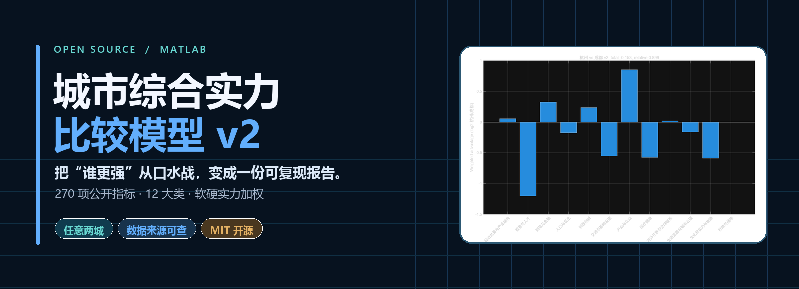

<div align="center">



# 城市综合实力比较模型 v2

**把“谁更强”从口水战，变成一份可复现的报告。**

输入两座城市的数据表，得到硬实力、软实力、综合优势、12 大类强弱分布和逐项胜负统计。
MATLAB 实现，MIT 开源，数据来源逐项可查。

[](#快速开始)
[](#实测效果)
[](https://github.com/hwkiller-0314/city-comparison-model/issues/new?template=%E7%82%B9%E5%8D%95%E5%9F%8E%E5%B8%82.md)
[](https://github.com/hwkiller-0314/city-comparison-model/stargazers)


[简体中文](README.md) · [English quick summary](README.en.md)

</div>

---

## 30 秒看懂

| 你给它 | 它给你 |
|---|---|
| 一份 270 项指标的权重表 | 硬实力 / 软实力 / 综合优势 |
| 一份两座城市的公开数据表 | 12 个大类的加权强弱分布 |
| 两座城市名称与输出前缀 | 胜负统计、相对强度指数和分类图 |
| 数据年份与来源 | 可复核、可复现的 CSV、TXT 与 PNG |

这不是一个“输入城市名就自动出榜单”的黑箱。它更像一套公开的尺子：指标、权重、折扣、方向和来源都摆在桌面上，你可以直接检查、修改和复现。

## 为什么它和一拍脑袋的排行榜不一样

- **不是只比 GDP。** 覆盖经济、产业、财政金融、人口民生、医疗、交通、教育、科技、文化、生态、行政 12 个大类。
- **不是把相关指标重复相加。** 对 GDP、工业、财政等高度相关项设置冗余折扣，避免经济规模被换着名字重复计算。
- **不是简单赢一项加一分。** 单指标使用 `log2(A/B)` 衡量差距，并截断极端值，减少单项冠军带偏全局。
- **不是无来源数据。** 统计公报、统计年鉴和权威榜单逐条记录，缺失项留空，不把未知写成 0。
- **不是只给结论。** 同时输出分类图、胜负项和相对强度，方便你质疑、复算和改权重。

## 实测效果


> 示例：杭州 vs 成都。综合指数 89.92，表示成都为 100 时，杭州约为 89.92。模型同时保留了杭州在科技创新、财政金融和产业企业等分类中的优势。

## 快速开始

**1. 准备两张表**

```text
权重表：原表指标, 规范指标, 类别, 实力类型, 指标方向, 基准权重, 冗余折扣系数, 最终有效权重, 特殊计分规则
数据表：原表指标, 规范指标, 城市A值, 城市B值, 数据年份, 数据来源, 单位, 是否更新
```

仓库已经提供 [通用权重v2.csv](通用权重v2.csv) 与 [数据模板v2.csv](数据模板v2.csv)。

**2. 把 `city_pair_model_v2.m` 和两张表放进同一文件夹。**

**3. 在 MATLAB 中执行**

```matlab
city_pair_model_v2('通用权重v2.csv', '数据表.csv', '杭州', '成都', '杭州成都')
```

**4. 得到四个产物**

| 文件 | 用途 |
|---|---|
| `杭州成都综合实力总览v2.csv` | 硬实力、软实力、综合优势与相对强度指数 |
| `杭州成都综合实力结果v2.csv` | 12 个大类的加权优势与胜负项 |
| `杭州成都综合实力摘要v2.txt` | 一段话结论，可直接贴进报告 |
| `杭州成都综合实力分类图v2.png` | 适合放进论文、PPT 或文章的对比图 |

第一次接触 MATLAB？看 [MATLAB 小白喂数据流程.md](MATLAB小白喂数据流程.md)，从表格字段到运行结果的步骤都写好了。

<details>
<summary><strong>查看已跑的 16 组城市对比</strong></summary>

| 城市组合 | 硬实力 | 软实力 | 综合 | 前城综合指数 |
|---|---:|---:|---:|---:|
| 北京 对 上海 | -0.01379 | +0.44628 | +0.12423 | 108.99 |
| 北京 对 天津 | +0.80226 | +1.53685 | +1.02264 | 203.16 |
| 上海 对 深圳 | +0.34664 | +0.61679 | +0.42768 | 134.51 |
| 天津 对 沈阳 | +0.62655 | +0.92270 | +0.71540 | 164.19 |
| 沈阳 对 大连 | +0.09883 | -0.17045 | +0.01805 | 101.26 |
| 沈阳 对 哈尔滨 | +0.34265 | +0.36493 | +0.34933 | 127.40 |
| 沈阳 对 西安 | -0.40978 | -1.17759 | -0.64012 | 64.17 |
| 西安 对 天津 | -0.21043 | +0.02592 | -0.13952 | 90.78 |
| 杭州 对 苏州 | +0.01923 | -0.22684 | -0.05460 | 96.29 |
| 杭州 对 南京 | +0.18932 | -0.33914 | +0.03078 | 102.16 |
| 杭州 对 成都 | -0.06833 | -0.51391 | -0.20201 | 86.93 |
| 成都 对 广州 | -0.09650 | -0.18038 | -0.12166 | 91.91 |
| 北京 对 辽宁（省级） | +0.37337 | +1.61671 | +0.74637 | 167.76 |
| 广州 对 深圳 | -0.18036 | -0.28175 | -0.21078 | 86.41 |
| 广州 对 杭州 | +0.10399 | +0.40540 | +0.19441 | 114.43 |
| 阜新 对 铁岭 | -0.18509 | -0.86934 | -0.39037 | 76.29 |

完整数据见 [v2城市对比总览.csv](v2城市对比总览.csv)。指数含义：后城为 100 时，前城的相对综合强度。

</details>

## 模型怎么算

1. **统一指标口径。** 把统计公报、年鉴和榜单中的不同字段映射到同一套规范指标。
2. **区分硬实力与软实力。** 当前基准权重为硬实力 70%、软实力 30%，并保留逐项权重表方便调整。
3. **处理重复信息。** 对高相关指标施加冗余折扣，降低“同一件事被算很多次”的影响。
4. **计算相对差距。** 正向指标使用 `log2(A/B)`，反向指标反向处理，单项结果截断在 ±3。
5. **按大类汇总。** 输出 12 类加权优势、胜负项和综合指数，而不是只给一个总分。

<details>
<summary><strong>为什么不能把它当成权威城市排名？</strong></summary>

这个模型是方向性比较工具，不是官方排名或城市价值的裁决书。

- 总量指标天然利好人口和经济规模更大的城市，换成人均口径后结论可能反转。
- 不同大类的数据可得性并不平均，有些类别的样本量仍然偏少。
- 博物馆、汽车保有量、农村居民收入等指标在不同城市的统计范围并不完全一致。
- “软 3 硬 7”和具体权重来自建模者判断，不是客观真理。

建议同时查看总量与人均口径，并把结果当作讨论的起点。详细审查见 [模型自审报告](docs/模型自审报告.md) 与 [补数据与复算报告](docs/补数据与复算报告.md)。

</details>

## Roadmap

<details>
<summary><strong>正在考虑的功能</strong></summary>

- [ ] 在线版：无需 MATLAB，在网页里直接选择两座城市
- [ ] 自动更新：通过 GitHub Actions 定期抓取公报并刷新对比总览
- [ ] 更多城市：覆盖全国主要城市，欢迎点单
- [ ] 英文文档与国际化
- [ ] 敏感性分析：输出基准值、区间与权重扰动结果

</details>

## 参与贡献

- 想看新的城市组合？打开 [点单城市 Issue](https://github.com/hwkiller-0314/city-comparison-model/issues/new?template=%E7%82%B9%E5%8D%95%E5%9F%8E%E5%B8%82.md)。
- 发现数字错误、口径过时或来源不完整？通过 [数据纠错 Issue](https://github.com/hwkiller-0314/city-comparison-model/issues/new?template=%E6%95%B0%E6%8D%AE%E7%BA%A0%E9%94%99.md) 提交，注明来源。
- 想改权重、增加指标或写在线版？欢迎提交 Pull Request。
- 如果这套模型帮你省下了整理数据的时间，点一个 [Star](https://github.com/hwkiller-0314/city-comparison-model/stargazers) 会让更多人看到它。

## 数据来源

- 各市统计公报：GDP、产业、财政、金融、人口、收入、医疗、交通等
- 各市统计年鉴：税收明细、用电量、工资等公报未披露项
- 软科中国大学排名：高校实力
- 复旦医院排行榜：医院实力
- 各部委名单：5A 景区、双一流、重点实验室等

所有数据均标注年份与来源。

## 引用

如果这个模型或论文对你有帮助，欢迎引用。引用信息见 [CITATION.cff](CITATION.cff)。

```bibtex
@software{chengshi_duibi_v2,
  title   = {城市综合实力比较模型 v2},
  author  = {hwkiller-0314},
  year    = {2026},
  url     = {https://github.com/hwkiller-0314/city-comparison-model}
}
```

## License

代码采用 [MIT License](LICENSE)。论文与文档采用 CC BY 4.0。

## English quick summary

A reproducible MATLAB model that compares any two Chinese cities across 270 public indicators, 12 categories, and weighted hard/soft-power dimensions. It outputs a CSV summary, category-level results, a plain-language report, and a publication-ready chart. The model is intended as a directional comparison tool, not an authoritative ranking. See [README.en.md](README.en.md) for details.
